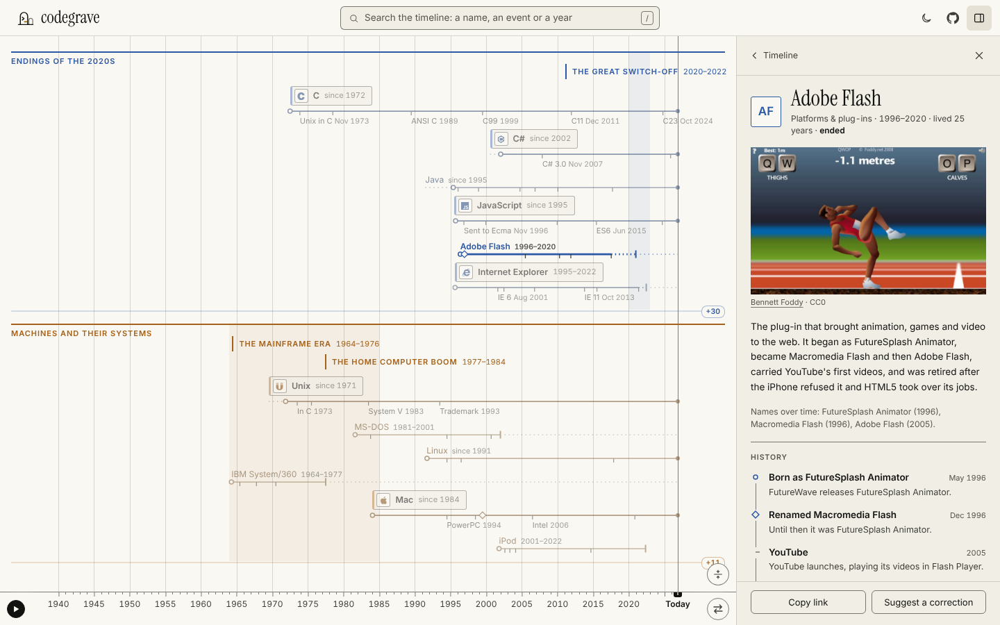
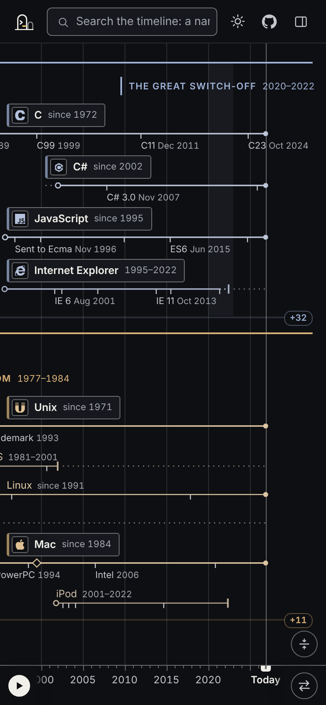

<h1 align="center">
  <picture>
    <source media="(prefers-color-scheme: dark)" srcset="docs/brand/logo-dark.svg">
    
  </picture>
</h1>

<p align="center"><em>Nothing ships forever.</em></p>

[codegrave.com](https://codegrave.com) is one page: a timeline of digital
things (languages, browsers, frameworks, machines and more) from first
release to official end. Time runs left to right with the years along the
bottom, and each thing is one line. Only things are listed, never people.
Click a line to read its history, with
dates, sources, official links and images.

<table>
  <tr>
    <td width="74%" valign="top"></td>
    <td width="26%" valign="top"></td>
  </tr>
  <tr>
    <td align="center"><sub>Wide screen, light theme</sub></td>
    <td align="center"><sub>Phone, dark theme</sub></td>
  </tr>
</table>

## What the page does

- **Views as sections.** A view is a named set of things, such as "Endings
  of the 2020s" or "Machines and their systems". Each view on the timeline
  gets its own section under a coloured heading, with its own named eras
  drawn in its colour.
- **Fit or Expand.** Fit (the button above reverse, bottom right) shares the
  screen height between the sections. Expand lets each section take what it
  needs and the page scrolls. Drag the grip under a section to make it
  shorter or taller; a shorter section keeps its best-ranked lines.
- **Showing.** In the panel, each view on the timeline is a row: drag it to
  reorder the sections, pick its colour from the dot, remove it with the
  cross, or shuffle all the colours.
- **Search.** The top search finds things, events, eras and years on the
  timeline. Below them it lists matches from views that are not on the
  timeline yet, and picking one adds that view.
- **Play and reverse.** Play moves a marker through time so the timeline
  shows only what had happened by then. Reverse flips the order of the lines.
- **One link for everything.** The address holds the views, their order and
  colours, the year range and the open thing, so any state can be shared.

The timeline is built in the open. Anyone can correct a fact, add a thing,
or propose a new view of the timeline.

## Quick start

You need [Node 22](https://nodejs.org/). There is nothing to install.

```sh
git clone https://github.com/ashrawan/codegrave.git
cd codegrave
node scripts/build.mjs                         # checks data/ and writes site/data/
python3 -m http.server 8080 --directory site   # serves the page on http://localhost:8080
```

| Command | What it does |
| --- | --- |
| `node scripts/build.mjs --check` | Checks every data file. Must print `0 errors`. |
| `node --test` | Runs the tests. |
| `node scripts/new.mjs thing <category> <id> "<Name>" <born-date>` | Starts a new thing file. |
| `node scripts/new.mjs view <id> "<Name>"` | Starts a new view file. |

Any static file server works in place of `python3 -m http.server`.

## How to take part

| You want to | Do this |
| --- | --- |
| Fix a wrong date or fact | Open a pull request that changes the thing's file and links a source, or open a "Correction" issue. |
| Add a thing that is missing | Open a pull request with one new file under `data/things/`, or a "New thing" issue if you only have the idea. |
| Propose a view | Follow [Propose a view](#propose-a-view) below. |
| Report something broken on the page | Open a "Bug" issue with a screenshot. |
| Suggest an idea or discuss a change | Open an "Idea or proposal" issue first, before writing code. |

Every pull request explains what it changes and why. A pull request that
changes what the page shows (a view, a thing, or the page itself) includes
screenshots. The full guide is in [`CONTRIBUTING.md`](CONTRIBUTING.md).

## Propose a view

A view is a named way of looking at the timeline, such as "The browser wars".
Anyone can propose one, and an AI coding assistant can do most of the work:
point it at [`AGENTS.md`](AGENTS.md) and [`docs/VIEWS.md`](docs/VIEWS.md).

1. **Fork this repository** and run the page locally (see Quick start).
2. **Build the view.** Add one file, `data/views/<id>.json`. Copy an existing
   view as a start; the fields are explained in `docs/VIEWS.md`. If your view
   needs things that are not on the timeline yet, add them too, one file each
   under `data/things/<category>/`, with sources, following
   `docs/DATA_RULES.md`.
3. **Check it.** `node scripts/build.mjs --check` must report 0 errors and
   `node --test` must pass. Open `http://localhost:8080/?views=<id>` and look
   at the result on a wide screen and a phone-sized window.
4. **Take screenshots** of the page showing your view: one wide, one narrow.
5. **Open a pull request** with the view file, any new thing files, and the
   screenshots in the description. The template asks what the view shows,
   why it is worth having, and where the facts come from.

The community reviews the pull request. Once it is merged, the view appears
under "Community" in the panel and anyone can add it beside other views.

## Layout of this repository

| Path | What it is | Who changes it |
| --- | --- | --- |
| `data/things/<category>/<id>.json` | One file per thing. The facts of the timeline. | Anyone, with sources |
| `data/views/<id>.json` | One file per view: a named way of looking at the timeline. | Anyone |
| `data/editors-choice.json` | The default view and the featured views. | Editors |
| `data/categories.json` | The categories. A view's named eras live in the view file. | Editors |
| `data/media/` | Icons and local images. | Anyone, with a licence |
| `site/` | The page: `index.html`, `styles.css`, `app.js`, `rank.js`. No framework. | Maintainers |
| `scripts/build.mjs` | Checks `data/` and bundles it into `site/data/` (generated, not committed). | Maintainers |
| `docs/` | The rules: `DATA_RULES.md` for things, `VIEWS.md` for views. | Maintainers |
| `schema/` | JSON Schemas that give editors hints while typing. | Maintainers |
| `tests/` | Tests for the ranking and the data. | Maintainers |
| `AGENTS.md` | The map for AI agents and new developers. | Maintainers |
| `.github/` | Pull request and issue templates, the check that runs on every pull request. | Maintainers |

The facts and the views are kept apart on purpose. A view only chooses what
to show. It cannot change a date, a name or a rank, so every view draws the
same timeline for the same thing.

## About the data

Every thing lists its sources, usually its Wikipedia article and an official
page, and dates are checked against them. An entry checked this way is marked
`"verified": true`. Images are hot-linked from Wikimedia Commons with each
file's author and licence, or kept in `data/media/` with theirs. Found a
mistake? A correction with a source is the most useful contribution there is.

## Deploy

Netlify runs `node scripts/build.mjs` and publishes `site/` (see
`netlify.toml`). If the check finds an error the deploy fails and the live
site keeps the last good data. Every pull request gets a preview link.

## Licence

Code is under the [MIT License](LICENSE); the written content and data are
under [CC BY-NC-SA 4.0](https://creativecommons.org/licenses/by-nc-sa/4.0/).
See [`LICENSE`](LICENSE) for which folders are which. Contributions are
licensed the same way.
