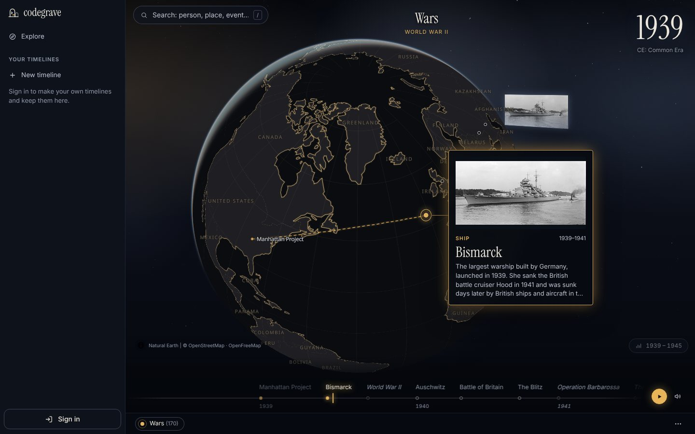
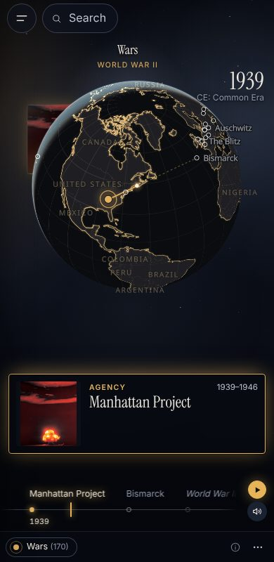
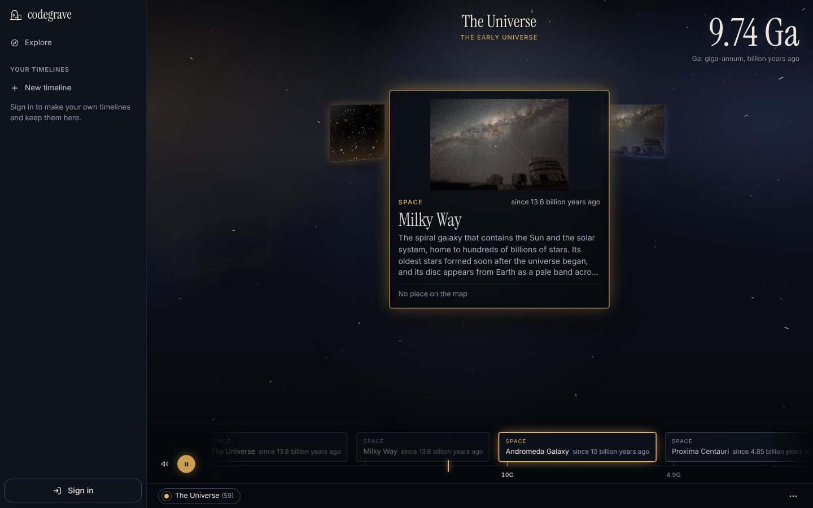

<h1 align="center">
  <picture>
    <source media="(prefers-color-scheme: dark)" srcset="docs/brand/logo-dark.svg">
    
  </picture>
</h1>

<p align="center"><em>Nothing ships forever.</em></p>

[codegrave.com](https://codegrave.com) is an encyclopedia drawn as a
timeline on the Earth. Every entry stands where it happened, and play
carries you through time from place to place: a person from birth to death,
an empire from founding to fall, a computer from launch to retirement.
Click any card to read its history, with dates, sources and pictures.

<table>
  <tr>
    <td width="74%" valign="top"></td>
    <td width="26%" valign="top"></td>
  </tr>
</table>

Try [Computers](https://codegrave.com/wiki/computer-generations) or
[The Universe](https://codegrave.com/wiki/the-universe).

## What you can do

- **Pick a subject.** About 230 views under five topics: Countries,
  Culture, History, Science and Technology (for example Ancient Egypt,
  Wars, Dinosaurs, Video Games, Nepal).
- **Play.** The globe turns from one place to the next at a steady pace,
  and each entry is written beside its pin as you reach it. Set the speed
  in the three-dot menu. Country views can play their national anthem.
- **Drag the time line.** The entries stand by name along the bottom; drag
  it, or click a name, to go there.
- **Leave the Earth.** A subject with no place on the map, such as The
  Universe, flies on among the stars, each picture filling the sky.
- **Search.** Find a person, a place, an event or a year (try `44 BCE`).
- **Make your own.** Describe a timeline in a sentence and it is written
  for you, to keep, edit and publish.
- **Share.** The link keeps the views and the open entry.

<p align="center"></p>

The map is drawn with MapLibre, OpenFreeMap and Natural Earth, and places
come from Wikidata.

The data is open: about 7,500 entries, each one file with its sources.
Anyone can fix a fact, add an entry or publish a view.

## Quick start

You need [Node 22](https://nodejs.org/). There is nothing to install.

```sh
git clone https://github.com/ashrawan/codegrave.git
cd codegrave
node scripts/build.mjs                         # checks data/ and writes site/data/
node scripts/serve.mjs 8080                    # serves the page on http://localhost:8080
```

| Command | What it does |
| --- | --- |
| `node scripts/build.mjs --check` | Checks every data file. Must print `0 errors`. |
| `node --test` | Runs the tests. |
| `node scripts/new.mjs entry <kind> <id> "<Name>" <born-date>` | Starts a new entry file in the base. |
| `node scripts/new.mjs view <github-name> <id> "<Title>"` | Starts a new view file in your community folder. |

A plain static file server shows the home page, but not a view's own
address (`/wiki/<id>`): that needs every unknown path to serve `index.html`,
as `scripts/serve.mjs` and Netlify do.

## How to take part

| You want to | Do this |
| --- | --- |
| Fix a wrong date or fact | Open a pull request that changes the entry's file and links a source, or open a "Correction" issue. |
| Add an entry that is missing | Open a pull request with one new file under `data/base/<kind>/`, or a "New entry" issue if you only have the idea. |
| Publish a view | Follow [Propose a view](#propose-a-view) below. |
| Report something broken on the page | Open a "Bug" issue with a screenshot. |
| Suggest an idea or discuss a change | Open an "Idea or proposal" issue first, before writing code. |

Every pull request explains what it changes and why. A pull request that
changes what the page shows (a view, an entry, or the page itself) includes
screenshots. The full guide is in [`CONTRIBUTING.md`](CONTRIBUTING.md).

## Propose a view

A view is one subject on the timeline under a plain name, such as "The
Space Race" or "Video Games". Anyone can publish one.

**Without code:** press "Propose a view" in the panel, or open the
[Propose a view](../../issues/new?template=propose-view.yml) form, and
describe it. To ask for a single missing entry, use the
[New entry](../../issues/new?template=new-thing.yml) form; the search offers
it when it finds nothing. Give a thumbs-up to the proposals you want: the
most wanted are built first.

**With code:** an AI coding assistant can do most of the work. Point it at
[`AGENTS.md`](AGENTS.md) and [`docs/VIEWS.md`](docs/VIEWS.md).

1. **Fork this repository** and run the page locally (see Quick start).
2. **Make your folder.** `node scripts/new.mjs view <your-github-name> <id> "<Title>"`
   creates `data/community/<your-github-name>/` with your profile and the
   view file. You only ever edit your own folder.
3. **Build the view.** List the entries it shows by id, and write its
   chapters; the fields are explained in `docs/VIEWS.md`. Use entries that
   are already in the base wherever you can: search the page, or
   `grep -rl '"name": "Ada Lovelace' data/base`. If the base lacks something,
   add it to the base in the same pull request, one file under
   `data/base/<kind>/`, with sources, following `docs/DATA_RULES.md`.
4. **Check it.** `node scripts/build.mjs --check` must report 0 errors and
   `node --test` must pass. Open
   `http://localhost:8080/<your-github-name>/<id>` and look at the
   result on a wide screen and a phone-sized window.
5. **Take screenshots** of the page showing your view: one wide, one narrow.
6. **Open a pull request** with your folder, any new base entries, and the
   screenshots in the description. The template asks what the view shows,
   why it is worth having, and where the facts come from.

Once it is merged, the view is listed in the panel, has its
own address (`codegrave.com/<your-github-name>/<id>`) and can be put
beside any other view.

## Layout of this repository

| Path | What it is | Who changes it |
| --- | --- | --- |
| `data/base/<kind>/<id>.json` | The base: one reviewed file per entry. The facts of the encyclopedia. | Anyone, with sources; editors review |
| `data/community/<owner>/` | One folder per person or group: `profile.json`, their `views/` and their own `entries/`. | Its owner |
| `data/categories.json` | The map: ten branches (Computing sits under Technology) and their kinds. | Editors |
| `data/labels.json` | The shared labels for what an entry or a view is about. | Editors |
| `data/editors-choice.json` | The default views, and the topics the panel lists the views under. | Editors |
| `data/redirects.json` | Old addresses that still work. | Editors |
| `data/media/` | Icons and local images. | Anyone, with a licence |
| `site/` | The page: `index.html`, `styles.css`, `app.js`, `rank.js`, `keys.js`. No framework. | Maintainers |
| `scripts/build.mjs` | Checks `data/` and writes what the page loads into `site/data/` (generated, not committed). | Maintainers |
| `docs/` | The rules: `DATA_RULES.md` for entries, `VIEWS.md` for views, `BUILD.md` for what the build writes. | Maintainers |
| `schema/` | JSON Schemas that give editors hints while typing. | Maintainers |
| `tests/` | Tests for the ranking, the dates and the build. | Maintainers |
| `AGENTS.md` | The map for AI agents and new developers. | Maintainers |
| `.github/` | Pull request and issue templates, the check that runs on every pull request. | Maintainers |

The facts and the views are kept apart on purpose. A view only chooses what
to show. It cannot change a date, a name or a rank, so every view draws the
same line for the same entry. Classical views (Everything, one per branch,
one per kind) are not files at all: the build makes them from the map.

## About the data

Every entry lists its sources, and its Wikidata item where it has one. Dates
are compared with those sources; an entry whose dates all agree is marked
`"verified": true`, and the rest are labelled as unverified on the page until
someone settles them. Wikidata is used for identity and dates only. The
summaries and chapter notes are original text, written for this site; no
text is copied from Wikipedia or any other source. Images are hot-linked from
Wikimedia Commons with each file's author and licence, or kept in
`data/media/` with theirs.

The first general-knowledge entries and views were drafted with AI
assistance and then checked against Wikidata and by review. Drafts can be
wrong. Found a mistake? A correction with a source is the most useful
contribution there is.

## Deploy

Netlify runs `node scripts/build.mjs` and publishes `site/` (see
`netlify.toml`). If the check finds an error the deploy fails and the live
site keeps the last good data. Every pull request gets a preview link.

## Licence

Code is under the [MIT License](LICENSE); the written content and data are
under [CC BY-NC-SA 4.0](https://creativecommons.org/licenses/by-nc-sa/4.0/).
See [`LICENSE`](LICENSE) for which folders are which. Contributions are
licensed the same way.
